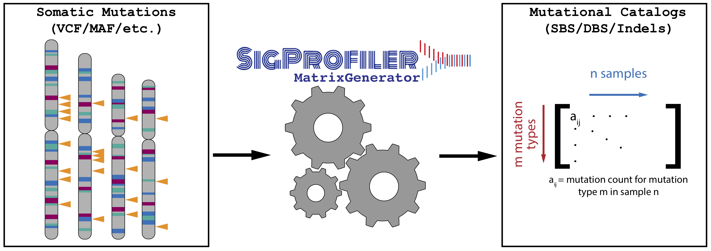

[](https://sigprofilersuite.github.io/SigProfilerMatrixGenerator/) [](https://opensource.org/licenses/BSD-2-Clause) [](https://github.com/SigProfilerSuite/SigProfilerMatrixGenerator/actions/workflows/ci.yml)
[](https://stats.uptimerobot.com/jjqW4Ulymx)

# SigProfilerMatrixGenerator
SigProfilerMatrixGenerator creates mutational matrices for all types of somatic mutations. It allows downsizing the generated mutations only to parts of the genome (e.g., exome or a custom BED file). The tool seamlessly integrates with other SigProfiler tools.

## CHM13 Support Added

This development branch adds **T2T-CHM13v2.0** support using the reference name
`CHM13-T2T` for SBS, DBS, and indel matrix generation in whole-genome, exome,
and custom BED analyses. It includes nuclear chromosomes 1-22, X, and Y;
mitochondrial variants are not supported. The exome regions are annotation-derived
CDS intervals, not a capture-kit definition.

Install this development branch and the validated `CHM13-T2T.tar.gz` archive
locally to test before FTP publication. Follow the
[CHM13 test example](docs/CHM13-Test-Example.md) for installation instructions,
downloadable synthetic VCF samples, runnable demo code, and expected results.
See [reference provenance](docs/Currently-Supported-Genomes.md) for sources and
checksums. This branch also supplies CHM13 whole-genome and exome opportunity
counts and chromosome distributions. It has not yet been released to PyPI.
These tables do not automatically enable downstream COSMIC signature matching;
see [CHM13 downstream compatibility](docs/CHM13-Downstream-Compatibility.md).

**INTRODUCTION**

The purpose of this document is to provide a guide for using the SigProfilerMatrixGenerator framework to generate mutational matrices for a set of samples with associated mutational catalogues. Full documentation is available in `docs/` (rendered via MkDocs): https://sigprofilersuite.github.io/SigProfilerMatrixGenerator/

For users that prefer working in an R environment, a wrapper package is provided and can be found and installed from: https://github.com/SigProfilerSuite/SigProfilerMatrixGeneratorR



**DOCUMENTATION**

- Source Markdown lives in `docs/` and is rendered via MkDocs to https://sigprofilersuite.github.io/SigProfilerMatrixGenerator/
- Local preview:
  - `python3 -m mkdocs serve`
  - `python3 -m mkdocs build && open site/index.html`
- Optional (mirror OSF wiki + images): `python3 tools/mirror_osf_wiki.py --node s93d5` (use `OSF_TOKEN=...` for private assets)
- Optional (offline images for existing docs): `python3 tools/fetch_osf_assets.py`

**PREREQUISITES**

The framework is written in PYTHON, however, it also requires the following software with the given versions (or newer):

  * PYTHON          version 3.8 or newer
  * WGET                   version 1.9  or RSYNC if you have a firewall

By default the installation process will save the FASTA files for all chromosomes for the default genome
assemblies (CHM13-T2T, GRCh37, GRCh38, mm10, mm9, rn6). As a result, ~3 Gb of storage must be available for the downloads for each genome.

**QUICK START GUIDE**

#### Using Python Interface:
This section will guide you through the minimum steps required to create mutational matrices:
1. Install the python package using pip:
    ```bash
    pip install SigProfilerMatrixGenerator
    ```
2. Install your desired reference genome from the command line/terminal as follows (a complete list of supported genomes can be found below):
    ```python
    $ python
    >> from SigProfilerMatrixGenerator import install as genInstall
    >> genInstall.install('GRCh37', rsync=False, bash=True)
    ```
        This will install the human 37 assembly as a reference genome. You may install as many genomes as you wish. If you have a firewall on your server, you may need to install rsync and use the rsync=True parameter. Similarly, if you do not have bash,
        use bash=False.
3. Place your vcf files in your desired output folder. It is recommended that you name this folder based on your project's name
4. From within a python session, you can now generate the matrices as follows:
    ```python
    $ python3
    >>from SigProfilerMatrixGenerator.scripts import SigProfilerMatrixGeneratorFunc as matGen
    >>matrices = matGen.SigProfilerMatrixGeneratorFunc("test", "GRCh37", "/Users/ebergstr/Desktop/test",plot=True, exome=False, bed_file=None, chrom_based=False, tsb_stat=False, seqInfo=False, cushion=100)
    ```
  The required parameters are as follows:
  ```python
  SigProfilerMatrixGeneratorFunc(project, reference_genome, path_to_input_files)
  ```

#### Using Command Line Interface (CLI):
1. After installing the package, you can directly call the tool using:
    ```bash
    SigProfilerMatrixGenerator <function-name> <arguments>
    ```
    Currently supported functions are 'install' and 'matrix_generator'.

2. For example, to install a reference genome:
    ```bash
    SigProfilerMatrixGenerator install GRCh37
    ```

   To install the validated CHM13 archive locally without FTP access, keep the
   exact filename `CHM13-T2T.tar.gz` and pass the directory that contains it:

    ```bash
    SigProfilerMatrixGenerator install CHM13-T2T \
      --local_genome /absolute/path/to/archive-directory
    ```

   The equivalent Python API is:

    ```python
    from SigProfilerMatrixGenerator import install as genInstall

    genInstall.install(
        "CHM13-T2T",
        offline_files_path="/absolute/path/to/archive-directory",
    )
    ```

   Both paths extract the archive into the configured reference location and
   verify all 24 chromosome files against the checksums registered by the
   installed package. The directory can be changed with CLI `--volume` or the
   Python `volume=` parameter.

3. To generate SBS, DBS, or INDEL matrices:
    ```bash
    SigProfilerMatrixGenerator matrix_generator <project> <reference_genome> <path_to_input_files>
    ```

View the table below for the full list of parameters.

**PARAMETERS**
| Category | Parameter | Variable Type | Parameter Description |
| ------ | ----------- | ----------- | ----------- |
| Required |  |  |  |
|  | project | String | The name of the project. |
|  | reference_genome | String | The name of the reference genome. Full list of genomes under **Supported Genomes** section. Supported values include the following: {c_elegans, c_elegans_Legacy, CHM13-T2T, dog, dog_Legacy, ebv, GRCh37, GRCh37_Legacy, GRCh38, GRCh38_Legacy, mm9, mm9_Legacy, mm10, mm10_Legacy, mm39, mm39_Legacy, rn6, rn6_Legacy, rn7, rn7_Legacy, yeast} |
|  | path_to_input_files | String | The path to the input files. |
| Optional |  |  |  |
|  | exome | Boolean | Downsamples mutational matrices to the exome regions of the genome. Default value False. |
|  | bed_file | String | Downsamples mutational matrices to custom regions of the genome. Requires the full path to the BED file. Default value None. Note: BED file header is required. |
|  | chrom_based | Boolean | Outputs chromosome-based matrices. Default value False. |
|  | plot | Boolean | Integrates with SigProfilerPlotting to output all available visualizations for each matrix. Default value False. |
|  | tsb_stat | Boolean | Outputs the results of a transcriptional strand bias test for the respective matrices. Default value False. |
|  | seqInfo | Boolean | Ouputs original mutations into a text file that contains the SigProfilerMatrixGenerator classificaiton for each mutation. Default value True. |
|  | cushion | Integer | Adds an Xbp cushion to the exome/bed_file ranges for downsampling the mutations. Default value 100. |
|  | indel_contexts | Sequence of strings | Optionally add Koh ID89 and/or ID476 counts, e.g. `("89", "476")`. Existing ID83 outputs remain unchanged. Default value None. |
|  | volume | String | Path to SigProfilerMatrixGenerator's volume where reference genomes will be saved and loaded from (for Docker/Singularity conatiners). The environmental variable 'SIGPROFILERMATRIXGENERATOR_VOLUME' takes precedence. Default value is None. |


### Optional ID89 and ID476 Counts

The development branch adds the [Koh et al. (2025)](https://doi.org/10.1038/s41588-025-02152-y)
indel classifications alongside the existing ID83 matrix. Install this branch
in a separate environment to test the feature; these instructions do not refer
to a new PyPI release:

```bash
python -m pip install --upgrade "git+https://github.com/SigProfilerSuite/SigProfilerMatrixGenerator.git@feature/id89-id476"
```

Request both additional count matrices with the CLI:

```bash
SigProfilerMatrixGenerator matrix_generator my_project CHM13-T2T /path/to/vcfs \
  --volume /path/to/reference-folder --indel_contexts 89 476
```

The optional matrices use the original variants and the installed reference DNA,
not a conversion of an existing ID83 matrix. No new reference archive is needed.
Whole-genome, exome and BED workflows are supported, including chromosome outputs.
The existing ID83 outputs are unchanged. Use literal, anchored VCF alleles and
the reference matching the coordinates of your variants. These are raw counts;
native plotting and downstream signature catalogues require separate support.
Complex replacements use an explicit absolute net length-change rule that is
not yet confirmed by the original authors. See the
[ID89/ID476 guide](docs/ID89-ID476.md) for Python examples, output files,
filtering rules, validation details and current input limitations.

**INPUT FILE FORMAT**

This tool currently supports maf, vcf, and simple text file. The user must provide variant data adhering to one of these three formats. If the user’s files are in vcf format, each sample must be saved as a separate files.


**OUTPUT FILE STRUCTURE**

The output structure is divided into three folders: input, output, and logs. The input folder retains copies of the user-provided input files in a separate subfolder for each run. Every run reads a fresh copy of the requested inputs, even when an output directory is reused. The outputfolder contains
a DBS, SBS, ID, and TSB folder (there will also be a plots folder if this parameter is chosen). The matrices are saved into the appropriate folders. The logs folder contains the error and log files for the submitted job.

## STRUCTURAL VARIANT MATRIX GENERATION

### INPUT FORMAT:

***First six columns are required, and either the column "svclass" (deletion, translocation, tandem-duplication, or inversion) or the columns "strand1" & "strand2" (BRASS convention, see https://github.com/cancerit/BRASS/wiki/BEDPE) must also be present***

### Example with SV class present (tsv or csv file):

| sample  | chrom1 | start1   | end1     | chrom2 | start2   | end2     | svclass  |
|:-------:|:------:|:--------:|:--------:|:------:|:--------:|:--------:|:--------:|
| Sample1 | 19     | 21268384 | 21268385 | 19     | 21327858 | 21327859 | deletion |

### Example without SV class present (tsv or csv file):

| sample  | chrom1 | start1   | end1     | chrom2 | start2   | end2     | strand1 | strand2 |
|:-------:|:------:|:--------:|:--------:|:------:|:--------:|:--------:|:-------:|:-------:|
| Sample1 | 19     | 21268384 | 21268385 | 19     | 21327858 | 21327859 | +       | +       |


### Quick Start Example: ###

```python
from SigProfilerMatrixGenerator.scripts import SVMatrixGenerator as sv
input_dir = "./SigProfilerMatrixGenerator/references/SV/example_input/560-Breast" #directory which contains collection of bedpe files (one per sample)
output_dir = "./SigProfilerMatrixGenerator/references/SV/example_output/"
project = "560-Breast"
sv.generateSVMatrix(input_dir, project, output_dir)
```
**Alternatively, you can run directly from the command line:**
```bash
SigProfilerMatrixGenerator sv_matrix_generator $input_dir $project $output_dir
```
## OUTPUT:
1. Annotated bedpe file - a file with each SV annotated with its type, size bin, and clustered/non-clustered status
2. Aggregate SV plot - a summary plot showing the average number of events in each channel for the whole cohort of samples
3. SV Matrix - a 32 X n matrix (where n is the number of samples) that can be used to perform signature decomposition, clustering, etc.

### VCF INPUT FORMAT:

**Note that VCF format (4.1, 4.2 and 4.3) is now supported. If using VCFs, please make sure the files in your input directory end with .vcf. Manta, Delly, Lumpy and GRIDSS are supported and example test files can be found in the [references/SV/](https://github.com/SigProfilerSuite/SigProfilerMatrixGenerator/tree/master/SigProfilerMatrixGenerator/references/SV) folder**

### Quick Start Example: ###

```python
#navigate to SVMatrixGenerator directory and start python3 interpreter

from SigProfilerMatrixGenerator.scripts import SVMatrixGenerator as sv
input_dir = "./SigProfilerMatrixGenerator/references/SV/example_input/VCF/" #directory which contains collection of VCF files (one per sample)
output_dir = "./SigProfilerMatrixGenerator/references/SV/example_output/"
project = "vcf-test" #test manta, delly, lumpy, and gridss vcf files
sv.generateSVMatrix(input_dir, project, output_dir)
```
**Alternatively, you can run directly from the command line:**
```bash
input_dir="./SigProfilerMatrixGenerator/references/SV/example_input/VCF/"
project="vcf-test"
output_dir="results"
SigProfilerMatrixGenerator sv_matrix_generator $input_dir $project $output_dir
```

## COPY NUMBER MATRIX GENERATION

In order to generate a copy number matrix, provide the an absolute path to a multi-sample segmentation file obtained from one of the following copy number calling tools (if you have individual sample files, please combine them into one file with the first column corresponding to the sample name):

1. ASCAT
2. ASCAT_NGS
3. SEQUENZA
4. ABSOLUTE
5. BATTENBERG
6. FACETS
7. PURPLE
8. TCGA

In addition, provide the name of the project and the output directory for the resulting matrix. The final matrix will be placed in a folder with the name of the project in the directory specified by the output path.

**An example to generate the CNV matrix is as follows:**

$ python3
```
>>from SigProfilerMatrixGenerator.scripts import CNVMatrixGenerator as scna
>>file_type = "BATTENBERG"
>>input_file = "./SigProfilerMatrixGenerator/references/CNV/example_input/Battenberg_test.tsv" #example input file for testing
>>output_path = "/Users/azhark/iCloud/dev/CNVMatrixGenerator/example_output/"
>>project = "Battenberg_test"
>>scna.generateCNVMatrix(file_type, input_file, project, output_path)

```

**Alternatively, you can run directly from the command line:**

```bash
SigProfilerMatrixGenerator cnv_matrix_generator BATTENBERG ./SigProfilerMatrixGenerator/references/CNV/example_input/Battenberg_test.tsv BATTENBERG-TEST ./SigProfilerMatrixGenerator/references/CNV/example_output/
```

## Reproducing earlier analyses

The corrected reference archives use the usual genome names (for example,
`GRCh38`). The previously distributed archives remain available under matching
`_Legacy` names (for example, `GRCh38_Legacy`). To rerun an earlier analysis,
install the Legacy reference and pass that same name to matrix generation:

```bash
SigProfilerMatrixGenerator install GRCh38_Legacy
SigProfilerMatrixGenerator matrix_generator previous_project GRCh38_Legacy /path/to/original_inputs
```

Replace `GRCh38` with the genome used in the original analysis. Legacy archives
are available for `GRCh38`, `GRCh37`, `mm9`, `mm10`, `mm39`, `rn6`, `rn7`, `dog`,
and `c_elegans`. An older reference already installed as `GRCh38` is not
automatically renamed to `GRCh38_Legacy`; install the Legacy identity explicitly.
Use the corrected name for new analyses. For an exact reproduction, also retain
the original input data, software versions, and analysis settings: the Legacy
archive alone cannot reproduce differences caused by software changes.

See the [Legacy reference guide](docs/Legacy-References.md) for Python and
offline installation instructions.

**SUPPORTED GENOMES**

This tool currently supports the following genomes:

T2T-CHM13v2.0 [CHM13-T2T] (Telomere-to-Telomere Consortium CHM13 assembly v2.0), INSDC
Assembly GCA_009914755.4. Nuclear chromosomes only (1–22, X, Y; no mitochondrion). WGS and exome matrices supported. The exome interval list is annotation-derived (merged CDS features from NCBI RefSeq annotation release GCF_009914755.1-RS_2025_08) rather than a capture-kit definition, so its exome matrices are not directly comparable to the GRCh37/GRCh38 ones; see docs/Currently-Supported-Genomes.md.

GRCh38.p12 [GRCh38] (Genome Reference Consortium Human Reference 38), INSDC
Assembly GCA_000001405.27, Dec 2013. Released July 2014. Last updated January
2018. The DNA sequence was downloaded from ENSEMBL database version 93.38.
The current `GRCh38` reference includes corrected transcription-strand
annotation and should be used for new analyses.

GRCh38 legacy TSB reference [GRCh38_Legacy] contains the GRCh38 reference data
distributed before the transcription-strand correction. It is retained only
to reproduce results from earlier SigProfilerMatrixGenerator releases. New
analyses should use `GRCh38`. Because the corrected reference is now the
default, users with an older `GRCh38` installation must reinstall `GRCh38`
after upgrading. To reproduce an old analysis, install and select
`GRCh38_Legacy` explicitly.

```python
from SigProfilerMatrixGenerator import install as genInstall

# Corrected reference for new analyses
genInstall.install("GRCh38")

# Former reference data, only for reproducing historical results
genInstall.install("GRCh38_Legacy")
```

The migration can change transcription-strand-aware matrices. Sequence-only
matrices such as SBS96 and ID83 are expected to remain unchanged because both
references use the same GRCh38 DNA sequence.

GRCh37.p13 [GRCh37] (Genome Reference Consortium Human Reference 37), INSDC
Assembly GCA_000001405.14, Feb 2009. Released April 2011. Last updated September 2013. This genome was downloaded from ENSEMBL database version 93.37.

`GRCh37` uses the corrected transcription-strand reference for new analyses.
Use `GRCh37_Legacy` only to reproduce results generated with the historical
pre-correction archive. Both identities use the same GRCh37.p13 DNA assembly;
strand-independent contexts are unchanged.

GRCm39 [mm39] (Genome Reference Consortium Mouse Reference 39), INSDC
Assembly GCA_000001635.9, Jun 2020. Last updated August 2020. This genome was downloaded from ENSEMBL database version 103.
The corrected `mm39` reference should be used for new analyses. Its DNA sequence
is unchanged, but corrected transcription-strand annotations can change
strand-aware mutation matrices. Rebuilt opportunity tables may also change
opportunity-based normalization, including sequence-only contexts; the raw
sequence-only mutation counts are unchanged. Install `mm39_Legacy` only to
reproduce results
from the previously distributed mm39 reference. After upgrading, an old local
`mm39` installation will fail checksum verification; reinstall `mm39` to obtain
the corrected archive. The two identities can be installed side by side.

```python
from SigProfilerMatrixGenerator import install as genInstall

genInstall.install("mm39")
genInstall.install("mm39_Legacy")  # Historical results only
```

The corrected archive is `mm39.tar.gz`; the original archive is preserved
byte-for-byte as `mm39_Legacy.tar.gz`. Source and validation details are in
[`reference_data/mm39/README.md`](reference_data/mm39/README.md).

GRCm38.p6 [mm10] (Genome Reference Consortium Mouse Reference 38), INDSDC
Assembly GCA_000001635.8, Jan 2012. Released July 2012. Last updated March 2018. The corrected reference was rebuilt from Ensembl release 94 sources; see [`reference_data/mm10/README.md`](reference_data/mm10/README.md). Use `mm10` for new analyses and `mm10_Legacy` only to reproduce historical results. Reinstall an existing `mm10` reference after upgrading.

GRCm37 [mm9] (Release 67, NCBIM37), INDSDC Assembly GCA_000001635.18.
Released Jan 2011. Last updated March 2012. This genome was downloaded from
ENSEMBL database version release 67. The current `mm9` reference includes
corrected transcription-strand annotation and should be used for new analyses.
The previously distributed data remains available as `mm9_Legacy` for
reproducing historical results. Existing `mm9` installations must be
reinstalled after upgrading.

```python
from SigProfilerMatrixGenerator import install as genInstall

# Corrected reference for new analyses
genInstall.install("mm9")

# Former reference data, only for reproducing historical results
genInstall.install("mm9_Legacy")
```

The migration can change transcription-strand-aware matrices. Sequence-only
matrices such as SBS96 and ID83 are expected to remain unchanged because both
references use the same mm9 DNA sequence.

Rnor_6.0 [rn6] INSDC Assembly GCA_000001895.4, Jul 2014. Released Jun 2015. Last updated Jan 2017.
This genome was downloaded from ENSEMBL database version 96.6.

The default `rn6` reference has corrected transcription-strand labels. The
previously distributed chromosome files are available as `rn6_Legacy` only to
reproduce old analyses. Both references use identical DNA, so raw sequence-only
matrices such as SBS96 and ID83 should match. Strand-aware matrices and
opportunity-based normalization may differ. The corrected archive is
`rn6.tar.gz`; the original archive is retained byte-for-byte as
`rn6_Legacy.tar.gz`. Reinstall an existing `rn6` reference after upgrading.
Source and validation details are in
[`reference_data/rn6/README.md`](reference_data/rn6/README.md).

mRatBN7.2 [rn7] (Wellcome Sanger Institute Rat Genome Assembly), INSDC Assembly GCA_015227675.2, Nov 2020. Last updated March 31, 2021 (`rn7.fa.gz` from UCSC). Downloaded from UCSC: [rn7 bigZips](http://hgdownload.soe.ucsc.edu/goldenPath/rn7/bigZips/).

The corrected `rn7` reference is the default for new analyses. The former
reference is available as `rn7_Legacy` to reproduce historical results. Both
use the same DNA sequence; transcription-strand labels and opportunity tables
may differ. Existing `rn7` installations must be reinstalled after upgrading.
See [rn7 reference correction](reference_data/rn7/README.md)
for source checksums, validation, and release details.

Epstein-Barr Virus [EBV] NC_007605.1, Nov 2005. Last updated Aug 2018. This genome was downloaded from the NCBI database: https://www.ncbi.nlm.nih.gov/nuccore/82503188/.

CanFam3.1 [dog] GCA_000002285.2, Sep 2011. Last updated Jun 2019. This genome was downloaded from ENSEMBL database version 100.

The corrected `dog` reference is the default for new analyses. The former
reference is available as `dog_Legacy` to reproduce historical results. Both
use the same DNA sequence; transcription-strand labels can differ. Existing
`dog` installations must be reinstalled after upgrading.
The bundled transcript coordinates match Ensembl release 93 far better than
release 100; see [dog reference correction](reference_data/dog/README.md) for
the source comparison and checksums.

WBcel235 [c_elegans] GCA_000002985.3, Oct 2014. Last updated Jan 2019. This genome was downloaded from ENSEMBL database version 100.

The corrected `c_elegans` reference is the default for new analyses. The
former reference is available as `c_elegans_Legacy` to reproduce historical
results. Both use the same DNA sequence; transcription-strand labels can
differ. Existing `c_elegans` installations must be reinstalled after upgrading.
All bundled transcripts match Ensembl release 100
exactly; see
[c_elegans reference correction](reference_data/c_elegans/README.md) for the
source comparison and checksums.

*One can specify "_havana" to the end of the genome to include annotations in t-cell receptor genes and IG clusters (available for GRCh37, GRCh38, and mm10). These historical Havana references are known to contain the pre-correction transcription-strand boundary and overlap defect. No corrected Havana archives are currently available. MatrixGenerator emits a runtime warning and continues so that historical analyses remain reproducible; transcription-strand-aware results may be affected.*

**LOG FILES**

All errors and progress checkpoints are saved into *sigProfilerMatrixGenerator_[project]_[genome].err* and *sigProfilerMatrixGenerator_[project]_[genome].out*, respectively.
For all errors, please email the error and progress log files to the primary contact under CONTACT INFORMATION.

**UNIT TESTS**

Unit tests can be run with the following commands:

```bash
python setup.py sdist
pip install .[tests]
pytest tests
```

**END-TO-END TESTS**

An integration test can be run with the following commands:

```bash
wget ftp://alexandrovlab-ftp.ucsd.edu/pub/tools/SigProfilerMatrixGenerator/GRCh37.tar.gz -P ./src/
pip install .
SigProfilerMatrixGenerator install GRCh37
python3 test.py -t GRCh37
```

**CITATION**

**For SBSs, DBSs, and INDELs, please cite the following paper:**

Bergstrom EN, Huang MN, Mahto U, Barnes M, Stratton MR, Rozen SG, and Alexandrov LB (2019) SigProfilerMatrixGenerator: a tool for visualizing and exploring patterns of small mutational events. **BMC Genomics** 20, Article number: 685.
https://bmcgenomics.biomedcentral.com/articles/10.1186/s12864-019-6041-2

**For SVs and CNVs, please cite the following paper:**

Khandekar A, Vangara R, Barnes M, Díaz-Gay M, Abbasi A, Bergstrom EN, Steele CD, Pillay N, and Alexandrov LB (2023) Visualizing and exploring patterns of large mutational events with SigProfilerMatrixGenerator. **BMC Genomics** 24, Article number: 469.
https://doi.org/10.1186/s12864-023-09584-y

**COPYRIGHT**

Copyright (c) 2019, Erik Bergstrom [Alexandrov Lab] All rights reserved.

Redistribution and use in source and binary forms, with or without modification, are permitted provided that the following conditions are met:

Redistributions of source code must retain the above copyright notice, this list of conditions and the following disclaimer.

Redistributions in binary form must reproduce the above copyright notice, this list of conditions and the following disclaimer in the documentation and/or other materials provided with the distribution.

THIS SOFTWARE IS PROVIDED BY THE COPYRIGHT HOLDERS AND CONTRIBUTORS "AS IS" AND ANY EXPRESS OR IMPLIED WARRANTIES, INCLUDING, BUT NOT LIMITED TO, THE IMPLIED WARRANTIES OF MERCHANTABILITY AND FITNESS FOR A PARTICULAR PURPOSE ARE DISCLAIMED. IN NO EVENT SHALL THE COPYRIGHT HOLDER OR CONTRIBUTORS BE LIABLE FOR ANY DIRECT, INDIRECT, INCIDENTAL, SPECIAL, EXEMPLARY, OR CONSEQUENTIAL DAMAGES (INCLUDING, BUT NOT LIMITED TO, PROCUREMENT OF SUBSTITUTE GOODS OR SERVICES; LOSS OF USE, DATA, OR PROFITS; OR BUSINESS INTERRUPTION) HOWEVER CAUSED AND ON ANY THEORY OF LIABILITY, WHETHER IN CONTRACT, STRICT LIABILITY, OR TORT (INCLUDING NEGLIGENCE OR OTHERWISE) ARISING IN ANY WAY OUT OF THE USE OF THIS SOFTWARE, EVEN IF ADVISED OF THE POSSIBILITY OF SUCH DAMAGE.

**CONTACT INFORMATION**

Please address any queries or bug reports to Erik Bergstrom at ebergstr@health.ucsd.edu. Please address any queries or bug reports related to CNV's or SV's to Azhar Khandekar at akhandek@eng.ucsd.edu. Additional support can be provided by Mark Barnes at mdbarnes@health.ucsd.edu.
